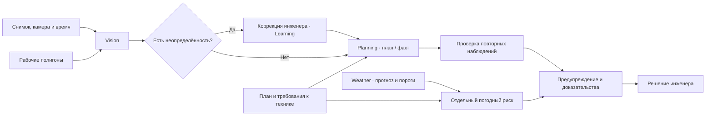
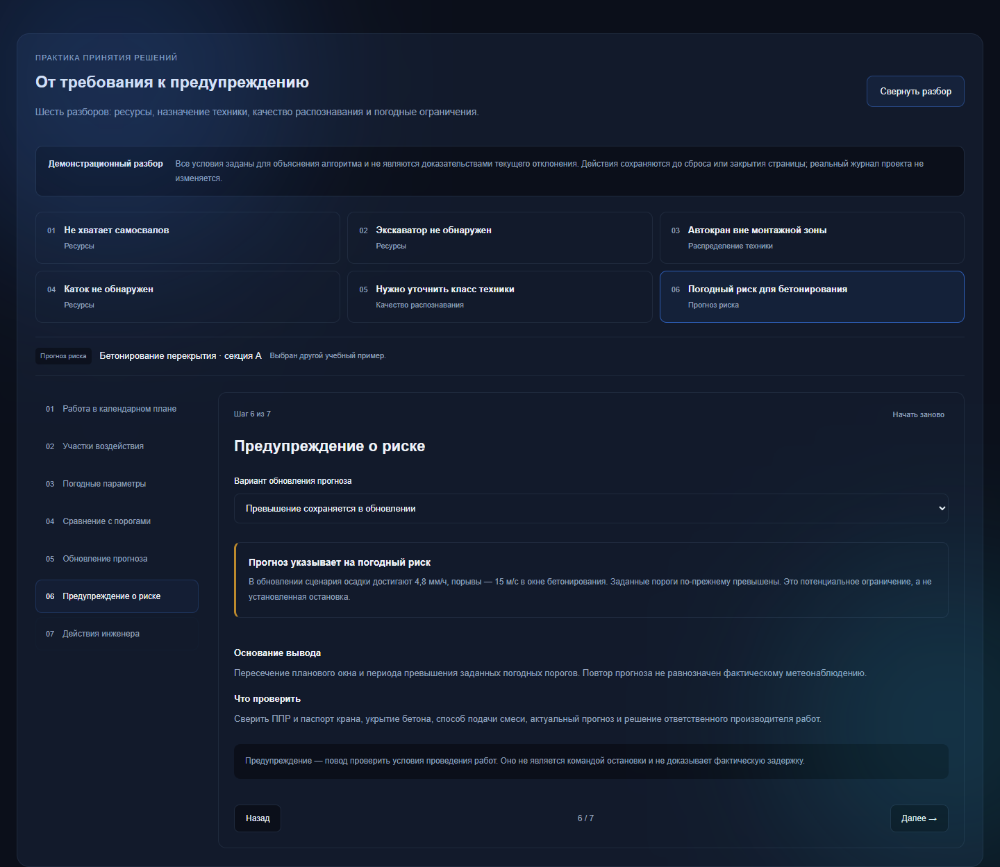
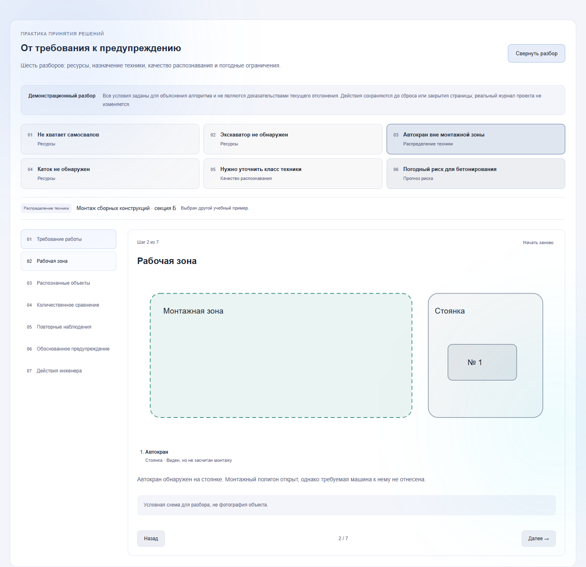

<p align="center"><picture><source media="(prefers-color-scheme: dark)" srcset="frontend/public/buildvision-dark.svg"></picture></p>

# BuildVision

**Контроль строительных работ: от снимка до проверяемого предупреждения.**

BuildVision сопоставляет технику в рабочих зонах с требованиями календарного плана. Инженер видит не только расхождение, но и его основания: исходный кадр, засчитанные объекты, версию правила, повторные наблюдения и историю решений.

[Открыть систему](https://eksupernova.su) · [Документация](docs/README.md) · [Руководство в PDF](frontend/public/BuildVision-documentation.pdf) · [Презентация](docs/BuildVision_defense.pptx)

## Основной сценарий

1. Загрузить снимок, указать камеру и подтвердить дату съёмки.
2. Определить активные работы и применимые рабочие полигоны.
3. Распознать классы техники и исключить объекты, не относящиеся к работе.
4. Сравнить засчитанное количество с ресурсным требованием.
5. Проверить независимость и сопоставимость повторных наблюдений.
6. Передать предупреждение инженеру с доказательствами и историей обработки.

Нехватка техники в видимой зоне не равнозначна доказанному простою или измеренному отставанию. Статус подтверждения наблюдения и критичность работы оцениваются отдельно.

## Единый аналитический контур

| Модуль | Назначение | Реализация |
| --- | --- | --- |
| **Vision** | Распознавание техники, рамки и пространственные зоны | YOLO-World, фильтрация по рабочим полигонам; дополнительная разметка хранится отдельно |
| **Learning** | Проверка спорных объектов инженером и обучение корректора | Канбан, редактор рамок, CLIP-эмбеддинги и классификатор; управляемая публикация версии |
| **Weather** | Погодные риски в интервале назначенных работ | Метеоданные и настраиваемые технологические пороги |
| **Planning** | Требования к ресурсам, сопоставление и расчёт графика | Количественные правила, зависимости, критический путь и сценарный прогноз |



Численные проверки выполняет локальный Python-модуль. Инструментальное подключение локальной Qwen рассматривается как развитие ассистента; текущие структурированные расчёты от языковой модели не зависят.

## Интерфейс и объяснимость

В карточке отклонения доступен раздел **«Разобрать логику отклонения»**. Шесть учебных случаев показывают ресурсный дефицит, назначение крана работе, неопределённое распознавание и погодный риск. У каждого случая — собственные условия, наблюдения и действия инженера. Учебные действия не меняют реальные записи проекта.



<details>
<summary>Светлая тема и привязка техники к рабочей зоне</summary>



</details>

В системе также доступны проекты и роли, архив камер, редактор зон, три представления календарного плана, прогноз и аналитика, журнал отклонений и коррекции распознавания. Мобильный клиент использует тот же API.

## Технологии

- **Сервер:** Python, FastAPI, Django ORM и административный интерфейс, PostgreSQL.
- **Распознавание:** YOLO-World, PyTorch, CLIP; scikit-learn для корректора классов.
- **Веб:** React, TypeScript, Vite, Leaflet; светлая и тёмная темы.
- **Мобильный клиент:** Capacitor, React, Android.
- **Развёртывание:** Docker Compose, nginx, HTTPS.

Версии зависимостей зафиксированы в `backend/requirements.txt`, `admin_panel/requirements.txt` и lock-файлах веб-клиентов.

## Запуск и проверка

Подробные инструкции: [разработка и тесты](docs/DEVELOPMENT.md), [описание системы и развёртывание](docs/PROJECT_DOCUMENTATION.md).

```bash
cp .env.example .env
# Заполнить пароли, секрет Django и адреса окружения.
# Подготовить веса модели и CLIP по инструкции в docs/DEVELOPMENT.md.
docker compose up --build -d
```

Основной интерфейс — `http://localhost:8000`, административный — `http://localhost:8001/admin/`. На чистой БД миграции применяются при запуске; пользовательские пароли задаются через окружение. Демонстрационные справочники заполняются отдельно.

```bash
cd frontend
npm ci
node --experimental-strip-types --test tests/*.test.ts
npm run build
```

GitHub Actions проверяет веб-клиент, предметные правила сопоставления и независимые визуальные доказательства. Проверки правил не заменяют валидацию качества детектора на размеченной выборке.

## Структура

```text
backend/          API, распознавание, сопоставление, прогноз и обучение
core/             Модели данных, миграции и интеграционные тесты
admin_panel/      Административный интерфейс и настройки Django
frontend/         Веб-интерфейс и тесты TypeScript
mobile/           Мобильный клиент Android
ml/               Подготовка обучающих данных
scripts/          Импорт, оценка моделей и команды обучения
data/config/     Словарь техники и начальные конфигурации
docs/            Документация, презентация и иллюстрации
deploy/          Пример настройки nginx
```

## Данные и конфигурация

В репозиторий не включаются рабочие `.env`, пароли, фотографии заказчика, выгрузки БД, веса моделей, журналы запусков и локальные кэши. Безопасные примеры окружения сохранены для воспроизводимого запуска.

Полнота обзора, режим присутствия техники и ресурсные требования согласуются инженером. Межкамерное устранение двойного счёта, автоматическое получение кадров из трансляций и фоновые push-уведомления требуют отдельной реализации; наличие внешней ссылки камеры не означает обработку видеопотока.


## Настройки видеопотоков

В настройках проекта доступно добавление подключения к существующей камере:

- прямой адрес RTSP, HTTP(S) или HLS; пароли и токены скрываются после сохранения;
- интервал получения кадров от 1 до 1440 минут, включая готовые варианты 5, 15, 30 и 60 минут;
- дни недели и часы работы, в том числе ночные смены, с часовым поясом объекта;
- суточный лимит от 1 до 1440 кадров;
- сохранение кадров либо сохранение с последующим анализом;
- изменение сохранённых настроек с проверкой версии записи.

Адрес источника хранится зашифрованным с серверным ключом. Сохранение настроек не запускает видеозахват. Обработчик вынесен в отдельный Docker Compose профиль `video-capture` и в текущей поставке не включается. Проверка потока, разовый захват и автоматическая обработка требуют отдельного запуска и проверки на источнике заказчика. Ссылки на страницы видеоплатформ не являются прямыми адресами потока.

Подробности развёртывания и сетевых ограничений — в [руководстве разработчика](docs/DEVELOPMENT.md).
